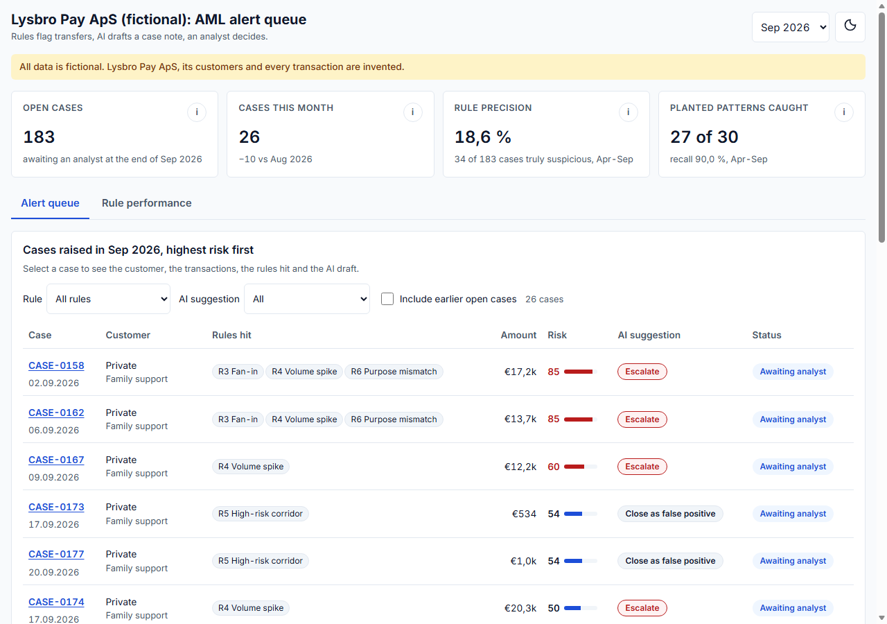

# AML Alert Queue: Lysbro Pay ApS (fictional)

**All data is synthetic.** Lysbro Pay ApS (fictional) is an invented Danish payment company; its 2.000 customers, their names, the foreign countries and every transaction are made up. Nothing comes from a real company or employer.



## The problem

A payment company has to monitor transfers for signs of money laundering. Rules catch suspicious-looking behaviour, but most alerts turn out to be ordinary: a car purchase, a seasonal business, a bonus month. Analysts spend their day reading cases to decide which ones to escalate. This project shows that workflow end to end, and tests whether AI can draft the case note and a suggested next step without inventing anything.

## What the dashboard shows

- **Four KPIs**: open cases, cases this month vs last month, rule precision (share of cases that were truly suspicious) and planted patterns caught (recall).
- **The alert queue**: cases sorted by risk score, with rules hit, amount involved, the AI suggestion (escalate or close as false positive) and the status "Awaiting analyst". Filters by rule and by AI suggestion.
- **Drill-down per case**: customer profile, declared purpose vs actual behaviour, a timeline of the customer's transactions with the triggering ones highlighted, the rules hit with plain-language reasons, and the AI draft with its checklist and check result. "AI suggestion only. An analyst decides."
- **Rule performance**: cases per rule split into truly suspicious and false positive, precision per rule, and the AI suggestion vs truth as a 2x2 table.
- **How this works**: data, rules and thresholds, risk score, what the AI sees, checks, evaluation, fairness check, limitations.

## How it is built

```
scripts/generate.py      2.000 customers, 74.228 transactions (Jan-Sep 2026; Apr-Sep shown), 30 planted suspicious customers
scripts/reconcile.py     PASS/FAIL: balances never negative, every transaction has a customer, row counts, fairness check
sql/01-16 (DuckDB)       one view per file: six rules (R1-R6), alerts, cases, risk score, KPIs, checks
scripts/build_db.py      builds data/aml.duckdb from the CSVs and config/rules.yaml, exports JSON to web/data/
scripts/write_summaries.py   Claude drafts a case note for every case (run once, stored in data/ai/)
scripts/check_summaries.py   checks every draft without AI
scripts/evaluate.py      the only script that reads the answer key; writes aggregate scores only
web/                     Next.js static site + Recharts; builds from web/ alone, no API calls at runtime
```

Every threshold and weight is an own assumption, set in one file: `config/rules.yaml` (listed in `docs/assumptions.md`).

## The AI part, and how it is checked

For each case, `claude-haiku-5-5` gets the customer profile (no name, no name origin), the rules hit with their reasons, the triggering transactions and a summary of the 90 days before the first alert. Nothing after the case date. Every amount is pre-formatted, so the model copies numbers instead of calculating them. It returns a 60-100 word summary, a suggestion (escalate / close as false positive), 1-3 reasons and a checklist of what the analyst must verify (for example "[Analyst: confirm source of funds]"). It never decides, and it is not allowed to say anyone committed a crime.

A script without AI checks every draft: every number must appear in the case data, no date after the case date, required fields, word limits, banned words. A failing draft gets one follow-up listing the failures, at most two retries, and the last attempt is kept.

## Results (one run, reported as they came out)

The metrics were written down before the AI ran (`docs/metrics.md`) and not changed afterwards.

**Rules: 183 cases, 34 truly suspicious, precision 18,6 %. Recall 27 of 30 planted customers (90,0 %)**: all 24 full-strength patterns, 3 of 6 weak versions built to sit just under a threshold.

| Rule | Cases | Truly suspicious | Precision | Its pattern caught |
|---|---:|---:|---:|---:|
| R1 Structuring | 15 | 7 | 46,7 % | 6 of 7 |
| R2 Pass-through | 18 | 5 | 27,8 % | 4 of 5 |
| R3 Fan-in | 15 | 15 | 100,0 % | 5 of 5 |
| R4 Volume spike | 97 | 27 | 27,8 % | 5 of 5 |
| R5 High-risk corridor | 64 | 6 | 9,4 % | 5 of 7 |
| R6 Purpose mismatch | 11 | 11 | 100,0 % | 6 of 6 |

**AI suggestion vs truth** (183 drafts):

| | AI: escalate | AI: close |
|---|---:|---:|
| Truly suspicious | 30 | 4 |
| Not suspicious | 70 | 79 |

The AI suggested escalating 88,2 % of truly suspicious cases; the 4 it would close are the costly error, and the reason an analyst decides. It suggested closing 53,0 % of false positives. No time saving is claimed: that would need analysts working with and without the drafts.

**Number check**: 134 of 183 drafts passed every check on the first attempt (73,2 %), 178 of 183 after retries (97,3 %). The 5 still failing are 1-3 words over the 100-word limit and are marked as failing on the dashboard.

**Cost**: USD 0,15 for the complete run (243 calls), about USD 0,16 including a partial run that crashed on a script bug. Cap: USD 2,00.

**Fairness**: the planted customers have the same name-origin mix as all customers (largest difference 1,6 points). Rules, AI and dashboard never see the name-origin group; per group, the share of cases stays within 3 points of the share of customers.

## Limitations

- The data is synthetic and the patterns were planted by the same person who wrote the rules, so the scores are easier than real life. R3 and R6 at 100 % precision would not survive real data.
- Precision and recall come from an answer key. A real team learns them only from analyst decisions and later outcomes.
- No analyst decisions exist, so every case is open and there is no feedback loop.
- Thresholds are own assumptions, not tuned or validated on real data. 183 cases is fewer than the "few hundred" aimed for; the thresholds were not loosened to reach it.
- One prompt, one run, one model. The AI figures measure agreement with the planted truth, not quality as judged by an analyst.

## Next version

- A threshold slider per rule, showing how precision and recall move (tuned on one period, checked on another).
- Analyst decisions in the queue, and a feedback loop that measures precision from them.
- A network view: shared senders and recipients across customers (mule networks).
- An analyst review of a sample of AI drafts.

## How to run

```
pip install -r requirements.txt
python scripts/run_all.py            # data, checks, rules, evaluation, export (no AI calls)
python scripts/write_summaries.py --dry-run   # AI inputs and worst-case cost, no calls
cd web && npm ci && npm run build    # static site in web/out
node tests/qa_edge.mjs               # from the project folder: UI checks in headless Edge, screenshots
```

The AI drafts are already stored in `data/ai/`; `write_summaries.py` refuses to run again while they exist. It needs the key in `PORTFOLIO_ANTHROPIC_KEY`; without it, no call is made and the dashboard shows a placeholder.

Read `docs/explain.md` for every formula and likely interview questions.

---

Built with Claude Code by Knut Barka, an economics student who builds finance tools with AI.
